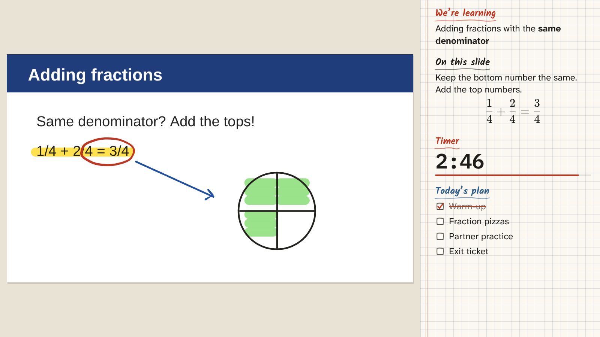
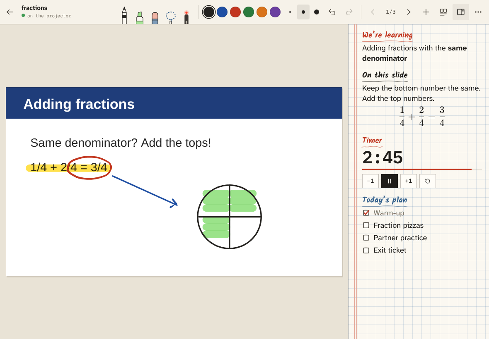

# Overhead

Your slides on the projector, your Apple Pencil on the iPad.

The laptop plugged into the projector shows your PDF big, with a column of
notes ("pods") down the right side: the lesson goal, a key formula, a timer,
a checklist. The iPad shows the same PDF. Write on it with the Pencil and the
ink appears on the projector as you write. Turn the page, scroll, or zoom on
the iPad and the projector follows.

It's a website, so there's nothing to install, and it runs entirely on free
plans: GitHub Pages hosts it, and Supabase stores your lessons and passes
the live ink between the two devices.





## What's in it

**On the iPad**
- Pressure-sensitive pen, highlighter (it goes *under* the printed text, like a real one), two erasers (whole stroke, or just what you rub), lasso to move / resize / recolour / copy / delete, and a laser pointer that fades.
- **Draw and hold** to straighten: a wobbly line becomes straight (it snaps level when it's nearly level), and circles, rectangles and triangles become clean shapes. Handy for number lines and geometry.
- Palm rejection: only the Pencil draws, fingers scroll and zoom. (There's a "draw with my finger" switch if you need it.)
- Pinch to zoom in and write small; the projector zooms in with you, or turn that off.
- Two-finger tap = undo, three-finger tap = redo. Double-tap with a finger to zoom in or back out.
- Add blank pages anywhere (plain, graph, lined, dots) for working problems out.
- Pods panel can be shown or hidden on the iPad. You edit pods on the laptop.
- "Cover the projector" puts up an *Eyes up here!* screen.
- Save the lesson as a PDF with your ink on it (to send to the class teacher, say).

**On the projector (laptop)**
- Pods, each with its own settings: **Notes** (Markdown + LaTeX math), **Timer**, **Checklist**, **Picture**.
- Notes pods can **keep** their text all lesson, or **wipe** with each page (each page gets its own notes, and they come back when you go back to that page).
- Drag the edge to make the pods column wider or narrower; text size per pod.
- Keyboard: <kbd>←</kbd> <kbd>→</kbd> pages, <kbd>E</kbd> edit pods, <kbd>P</kbd> hide pods, <kbd>B</kbd> cover, <kbd>F</kbd> full screen.

**Lessons**
- Two layouts: **Slides** (one page at a time, swipe to go on) and **Scroll** (pages stacked, for worksheets; the projector scrolls along with you).
- Your ink is saved, so it's still there next week. "Fresh copy for another class" gives you a clean copy of a lesson.

PowerPoint, Keynote and Google Slides: export to PDF first (File → Export /
Download → PDF). Rendering those formats directly in a browser is unreliable,
and a PDF always looks right.

## Setting it up

Do this once. It takes about 15 minutes.

### 1. Make a free Supabase project

1. Go to [supabase.com](https://supabase.com) and sign up (free, no card).
2. **New project**. Pick any name and database password, and the region closest to you.
3. Wait a minute or two while it gets ready.

### 2. Set up the database

1. In your project, open **SQL Editor** (left sidebar).
2. Open [`supabase/setup.sql`](supabase/setup.sql) from this repo, copy all of it, paste it in, and press **Run**.
   It should say *Success*. (Running it again later is harmless.)

### 3. Make your login

1. **Authentication → Users → Add user → Create new user.**
   Type your email and a password, and keep **Auto Confirm User** ticked.
2. Then lock the door behind you: under **Authentication → Sign In /
   Providers** (on some dashboards **Providers → Email**), turn **off**
   "Allow new users to sign up". Now nobody else can make an account on your
   project.

### 4. Turn on the website

1. In Supabase, press the **Connect** button at the top of your project and
   copy the **Project URL** (it ends in `.supabase.co`) and the
   **publishable** key (starts with `sb_publishable_`). You can also find
   them under **Project Settings → Data API** (URL) and **Project Settings →
   API Keys** (key; the older `anon` key works too). Both are safe to make
   public: the database only answers to your login.
2. In this GitHub repo: **Settings → Secrets and variables → Actions → Variables
   tab → New repository variable**, twice:
   - `SUPABASE_URL` = the project URL
   - `SUPABASE_ANON_KEY` = the anon / publishable key
3. **Settings → Pages → Build and deployment → Source: GitHub Actions.**
4. Merge to `main` (or run the *Deploy to GitHub Pages* workflow from the
   **Actions** tab). After a minute the site is live at
   **`https://<your-github-name>.github.io/bv/`**.

(If you skip the two variables, the site still works: it asks for the URL and
key the first time it's opened on each device.)

### 5. On the laptop

Open the site, sign in, and choose **The projector**.

### 6. On the iPad

Open the site in Safari, then **Share → Add to Home Screen**. Open it from
the Home Screen (it runs full screen that way, without Safari's toolbars),
sign in, and choose **My drawing pad**.

## In class

1. Plug the laptop into the projector, open the site, press <kbd>F</kbd> for full screen.
2. On the iPad, tap a lesson. It opens on the projector by itself.
3. Write. That's it.

The little dot next to the lesson title on the iPad says whether the
projector is connected. On the laptop, move the mouse to see the same
status at the bottom of the screen.

When the iPad is held upright on a worksheet, faint dashed lines show which
part of the page fits on the projector.

**Getting pods ready**: open the lesson on the laptop the night before (it
works without the iPad). Press <kbd>E</kbd>, click a pod to edit it, and use
<kbd>←</kbd> <kbd>→</kbd> to step through pages when writing per-page notes.

### Writing math in pods

| You type | You get |
| --- | --- |
| `$3 \times 4 = 12$` | 3 × 4 = 12 |
| `$\frac{3}{4}$` | three quarters, drawn as a big stacked fraction |
| `$$\frac{1}{4} + \frac{2}{4} = \frac{3}{4}$$` | a big centred equation on its own line |
| `$7 \div 2$`, `$\le$`, `$\ge$`, `$\neq$`, `$90^\circ$` | ÷, ≤, ≥, ≠, 90° |
| `**bold**`, `*italic*`, `- list item` | **bold**, *italic*, a bullet list |

The buttons above the text box insert the common ones for you.

## If something's wrong

- **"Can't reach Supabase"**: free projects go to sleep after a week of not
  being used. This repo includes a workflow (`Keep Supabase awake`) that
  pokes it twice a week once the two variables are set. If it's asleep
  anyway, open supabase.com, pick the project, and press **Restore**.
  (GitHub turns off scheduled workflows in repos with no activity for 60
  days. If that happens, re-enable it from the Actions tab.)
- **The projector says "iPad not connected"**: check both are signed in to the
  same account and online. School Wi-Fi needs to allow `*.supabase.co`; if
  it doesn't, a phone hotspot works fine.
- **Try it without any setup**: on the first screen pick "Just try it on this
  device". Open the site in two browser windows (one as projector, one as
  pad) to see the live sync. Nothing leaves the browser.

Free-plan limits are generous for this: 1 GB of file storage, 500 MB
of database, and 2 million live messages a month. A lesson with a lot of
writing uses a few tens of thousands.

## Working on it

```sh
npm install
npm run dev      # http://localhost:5173 (also reachable from the iPad on the same network)
npm run build    # type-check and build into dist/
```

To run against your Supabase project locally, either paste the URL and key
into the setup screen or put them in `.env.local`:

```
VITE_SUPABASE_URL=https://xxxx.supabase.co
VITE_SUPABASE_ANON_KEY=...
```

How it hangs together:

- `src/board/Board.ts`: the drawing surface. Three stacked canvases (page + highlighter, ink, live stroke), camera with pinch-zoom and momentum scroll, all the pencil tools. Strokes are drawn with [perfect-freehand](https://github.com/steveruiz/perfect-freehand).
- `src/lib/pdf.ts`: renders PDF pages with pdf.js: a screen-sized copy of each page, plus a sharp render of just the visible area when zoomed in.
- `src/lib/hub.ts`: the live link between your devices, a Supabase Realtime broadcast channel. Messages are batched about 20 times a second, and stroke points are merged.
- `src/lib/session.ts`: one open lesson: loading, saving ink (about a second after you stop writing), and applying changes from the other device.
- `src/pods/`: pods and the pod editor. Notes are Markdown + KaTeX.
- `supabase/setup.sql`: tables, row-level security, and the storage bucket.
